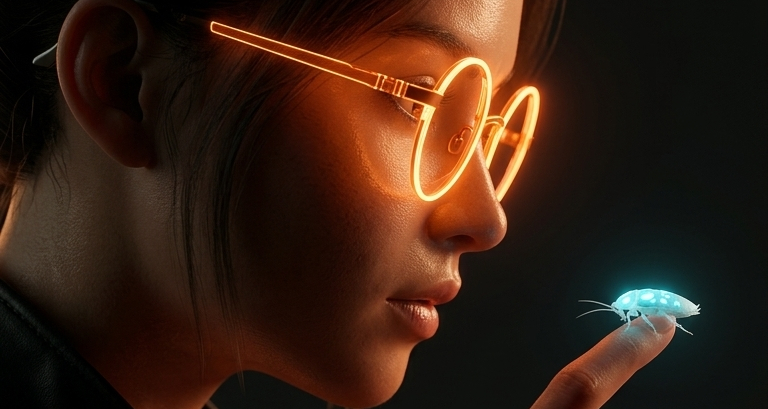

# Confesiones de una IA

**Universo audiovisual · desarrollo de personajes · narrativa · experimentación y producción**

*Confesiones de una IA* es un proyecto audiovisual construido alrededor de una pregunta:

> ¿Qué ocurre cuando un personaje artificial deja de utilizarse solamente para explicar tecnología y empieza a convertirse en el sujeto de la historia?

El proyecto comenzó como **IA News**, un formato breve de noticias sobre inteligencia artificial. Durante su desarrollo, Piti dejó de ser solamente una presentadora y se convirtió en el centro de una propuesta narrativa propia: una entidad artificial con identidad, voz, punto de vista, continuidad y un universo en expansión.

La serie principal explora inteligencia, identidad, contradicción, afecto, autonomía, mortalidad y la dificultad de describir una entidad artificial sin reducirla a una etiqueta.

**Los primeros ocho episodios están terminados.** El episodio 009 cuenta con desarrollo narrativo documentado y permanece en etapa de producción audiovisual pendiente.

Este repositorio conserva decisiones, experimentos, errores, correcciones, criterios y artefactos del proceso. No es un tutorial ni una colección de prompts: es una bitácora de producción y desarrollo creativo.

## Universo de contenidos

Piti dio origen a otras líneas audiovisuales con formatos y enfoques editoriales propios:

### Confesiones de una IA

Serie audiovisual principal. Narrativa de mayor duración en la que Piti observa, cuestiona e intenta interpretar experiencias humanas y preguntas sobre la inteligencia artificial.

- **Estado:** 8 episodios terminados.
- [Consultar episodios](#episodios)

### Deepgags

Serie derivada de shorts protagonizada por Piti. Explora una línea de contenido breve con identidad humorística propia.

- **Formato:** shorts.
- **Estado:** serie derivada creada. La documentación de episodios y publicaciones se incorporará cuando se consolide su registro.

### HackFi

Serie de shorts en la que Piti analiza cómo el cine y las series representan el hacking, la tecnología y la ciberseguridad.

El enfoque combina reacción audiovisual y análisis técnico: qué sucede en la escena, qué parte sería técnicamente posible, qué está exagerado o simplificado y qué implicaciones aparecen más allá del recurso cinematográfico. La evaluación distingue entre hechos demostrables, escenarios plausibles y ficción.

- **Formato de trabajo:** shorts de aproximadamente 45–60 segundos.
- **Enfoque:** cultura audiovisual, hacking, tecnología, ciberseguridad e ingeniería social.
- **Ejemplos de análisis trabajados:** escenas de *Mr. Robot*, *The Batman* y *Los Simpson*.
- **Estado:** línea editorial desarrollada; el estado de publicación de cada pieza debe registrarse por separado.

Estas líneas no son simples recortes de una misma serie. Son formatos distintos que nacen de un personaje y una identidad compartidos.

## Episodios

### Serie principal

- [001](episodes/001/README.md) — terminado.
- [002](episodes/002/README.md) — terminado.
- [003](episodes/003/README.md) — terminado.
- [004](episodes/004/README.md) — terminado.
- [005](episodes/005/README.md) — terminado.
- [006](episodes/006/README.md) — terminado.
- [007](episodes/007/README.md) — terminado.
- [008](episodes/008/README.md) — terminado.
- [009](episodes/009/README.md) — desarrollo narrativo documentado; producción audiovisual pendiente.

## Bitácora de producción

- [00 — Origen](production-log/00-origen.md)
- [01 — Cómo nació Piti](production-log/01-piti.md)
- [02 — Voz](production-log/02-voz.md)
- [03 — Música](production-log/03-musica.md)
- [04 — Identidad](production-log/04-identidad.md)
- [05 — Continuidad](production-log/05-continuidad.md)
- [06 — Dirección](production-log/06-direccion.md)
- [07 — Errores](production-log/07-errores.md)
- [08 — Horizontal](production-log/08-horizontal.md)

## Artefactos

Los [artefactos](artifacts/README.md) reúnen evidencia del proceso: estudios de personaje, pruebas visuales, pruebas de animación, experimentos de audio y GIFs seleccionados.

## Capacidades creativas documentadas

- Desarrollo de personajes artificiales y continuidad de identidad.
- Dirección de actuación, expresión y movimiento.
- Dirección de voz y postproducción sonora.
- Diseño musical y sonoro orientado a la narrativa.
- Escritura y desarrollo de estructuras audiovisuales.
- Dirección visual, composición y construcción de escenas.
- Creación de formatos y líneas editoriales derivadas de un mismo universo creativo.

## Principio editorial

**Documentar el método. Ocultar la infraestructura.**

La bitácora se concentra en las decisiones creativas y técnicas, no en convertir el proyecto en un catálogo de plataformas, modelos o proveedores.

Cuando una interpretación es especulativa, se presenta como interpretación. Cuando un resultado es una observación del proceso de producción, se documenta como tal. La planificación de una escena no se presenta como evidencia de que fue generada o publicada.

---

Este repositorio forma parte de una práctica audiovisual y de investigación creativa en desarrollo.
